# Google Commander

**A two-panel file manager for Windows in the style of Norton Commander from the 90s — for uploading files from your computer to Google Drive.**

[English](#english) · [Русский](#русский) · [Deutsch](#deutsch) · [Français](#français) · [Español](#español)

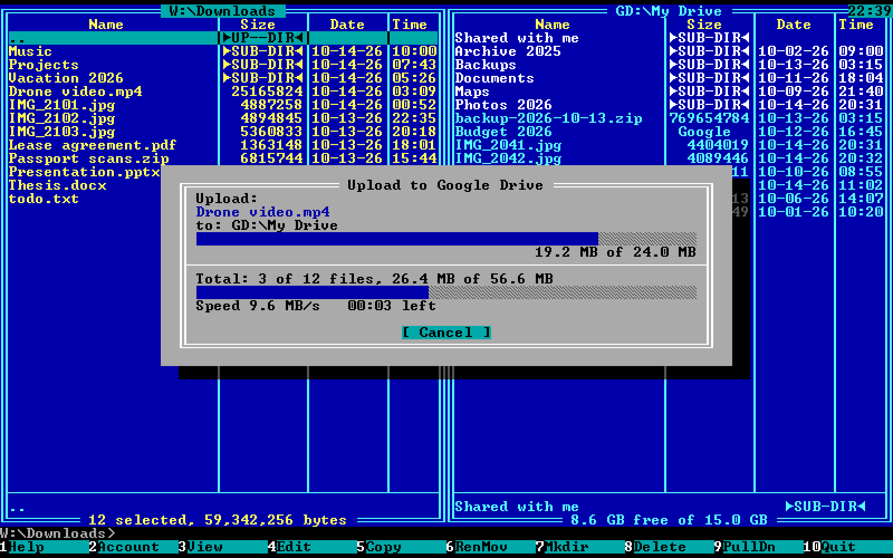

> Google Commander is an independent open-source project. It is not affiliated with, endorsed by or sponsored by Google LLC.
> Google and Google Drive are trademarks of Google LLC.

---

## English

The left panel shows the disks of your computer, the right panel shows your Google Drive. The whole screen is drawn as a real
16-colour text mode with the raster VGA fonts that ship with Windows (`vga866.fon`, `vga850.fon`).

- **Sign in with your Google account** (F2): the regular Google sign-in opens in your browser — the program never sees your password.
  Tokens are stored encrypted by Windows (DPAPI).
- **Free space on Google Drive** is always shown at the bottom of the Drive panel; F2 shows total, used, in trash and free space.
- **F5** uploads selected files and folders to Google Drive (resumable, 8 MB chunks, resumes after a dropped connection)
  and downloads them back. Google Docs, Sheets and Slides are exported as .docx / .xlsx / .pptx.
- F3 view, F4 edit, F6 move, Shift-F6 rename, F7 new folder, F8 delete (to the trash only), F9 menu, F10 quit,
  Alt-F1 / Alt-F2 choose drive, Insert / Gray + − * selection, quick search, drag and drop from Explorer, DOS-style command line.
- Interface languages: English, Russian, German, French, Spanish (F9 → Options → Language).

### Install

Download `GoogleCommander-<version>-setup.exe` (or the portable zip) from [Releases](../../releases). Windows 10/11 x64.

### Connect Google Drive (once)

Google lets a program access Drive only with an OAuth key from your own Google Cloud project. It is free and takes about 10 minutes:

1. Open [console.cloud.google.com](https://console.cloud.google.com/) and create a project.
2. **APIs & Services → Library → Google Drive API → Enable.**
3. **Google Auth Platform** (OAuth consent screen): type *External*, app name and your e-mail.
   Under **Audience** add your Gmail to *Test users*.
4. **Clients → Create client →** type **Desktop app** → Create, then **Download JSON**.
5. In Google Commander: **F9 → Options → Google OAuth key → Load JSON…**
6. Press **F2** — choose your Google account in the browser and allow access.

While the project is in *Testing* mode Google asks you to sign in again every 7 days. To avoid that, press **Publish app** under Audience;
Google will then warn that the app is not verified — it is your own key, choose *Advanced → Go to …*.

### Build from source

```
npm install
npm start
npm run icon
npm run package      → dist\GoogleCommander-<version>-setup.exe and -portable.zip (needs Inno Setup 6)
```

`electron . --demo` fills the Drive panel with sample data (used for the screenshots).

| | |
|---|---|
| 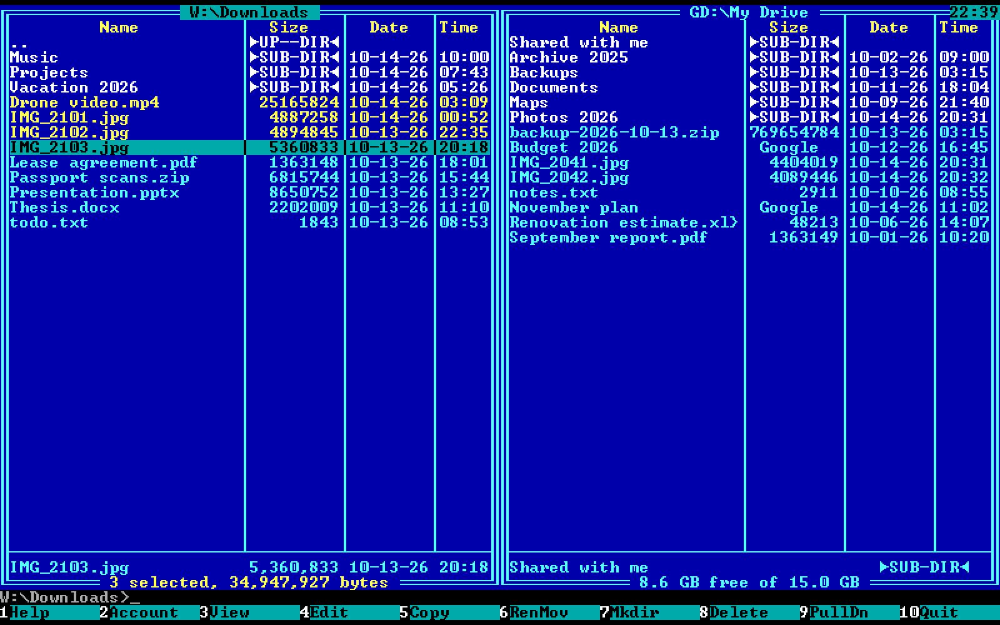 | 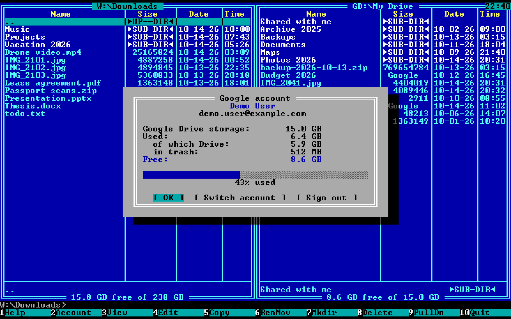 |
| 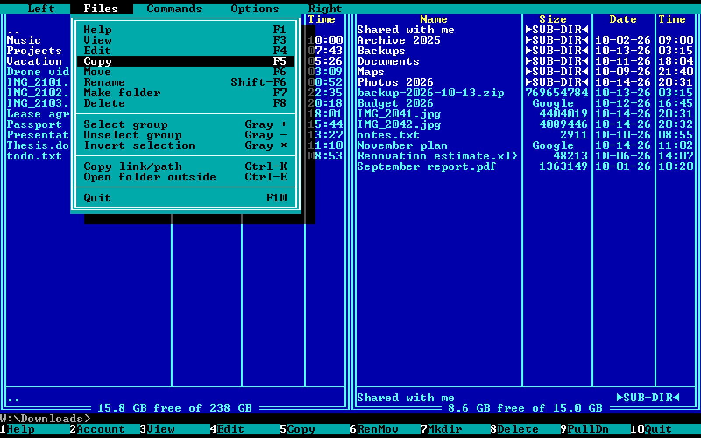 | 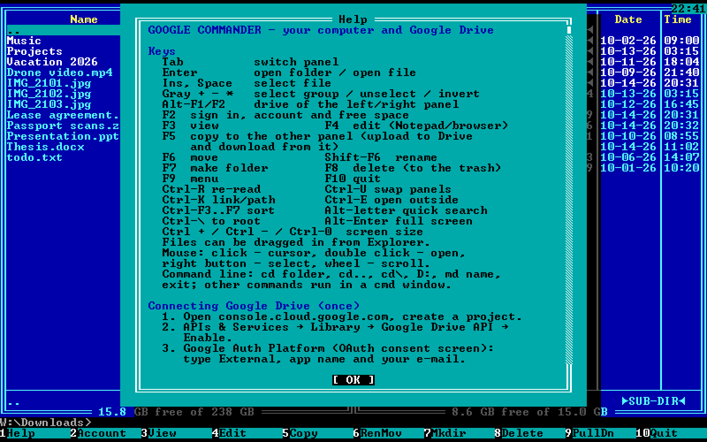 |
| 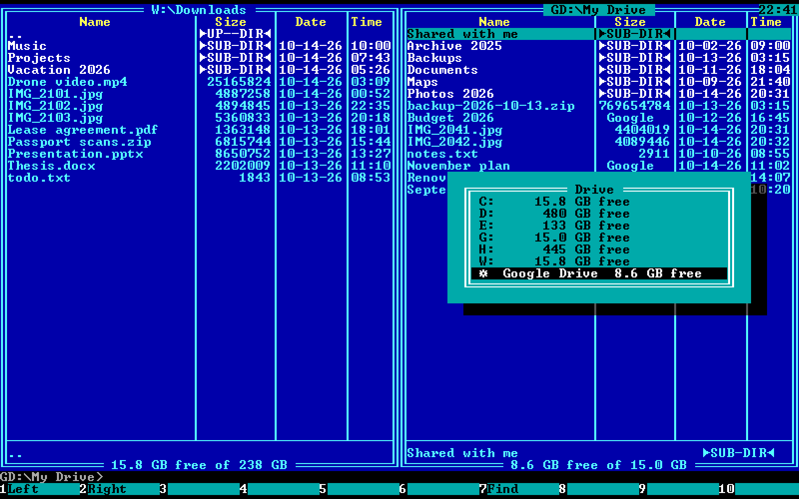 | 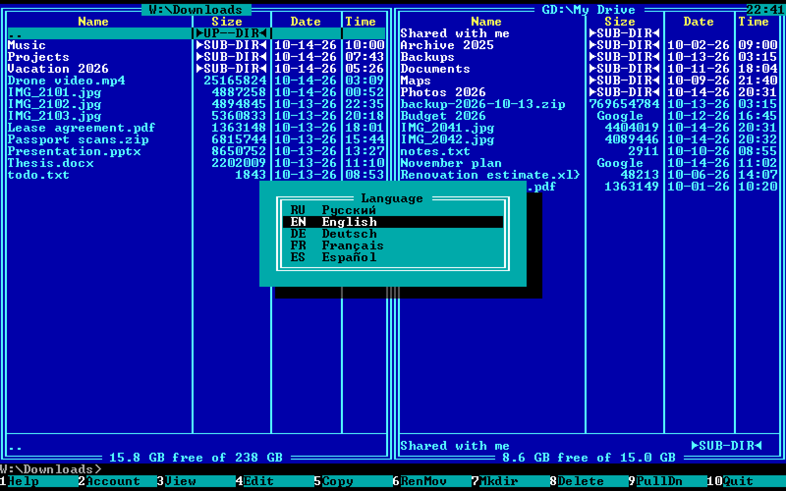 |

---

## Русский

Двухпанельный файловый менеджер в стиле Norton Commander 90-х: слева диски компьютера, справа ваш Google Drive.
Экран — настоящий 16-цветный текстовый режим со шрифтом VGA из Windows.

- **Вход через аккаунт Google** (F2) — окно входа Google открывается в браузере, пароль программа не видит.
- **Свободное место на Google Drive** — внизу панели, подробно — по F2.
- **F5** — загрузка файлов и папок на Google Drive (кусками, с докачкой) и скачивание обратно; документы Google — в .docx/.xlsx/.pptx.
- Подключение Google Drive — шаги выше (раздел *Connect Google Drive*) или F1 в программе.

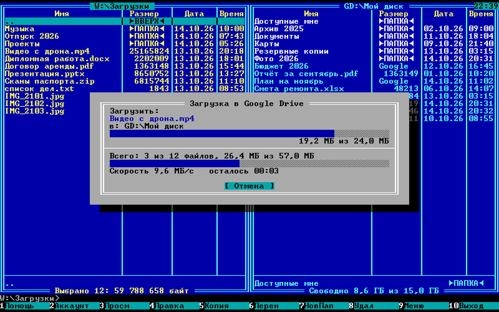

## Deutsch

Zweifenster-Dateimanager im Stil des Norton Commander: links Ihr Computer, rechts Ihr Google Drive. Anmeldung mit dem Google-Konto
im Browser (F2), freier Speicher unten im Fenster, F5 lädt hoch und herunter. Einrichtung des Google-Schlüssels: siehe oben oder F1.

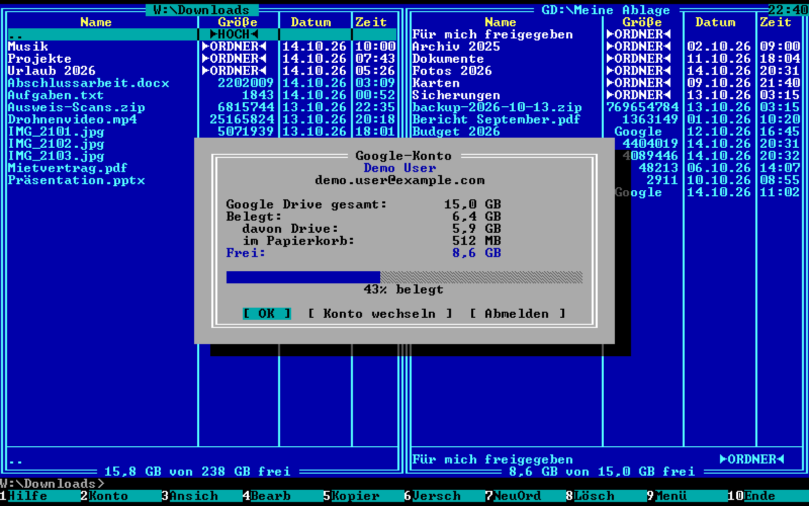

## Français

Gestionnaire de fichiers à deux panneaux dans le style de Norton Commander : votre ordinateur à gauche, votre Google Drive à droite.
Connexion avec votre compte Google dans le navigateur (F2), espace libre en bas du panneau, F5 envoie et télécharge.
Configuration de la clé Google : voir ci-dessus ou F1.

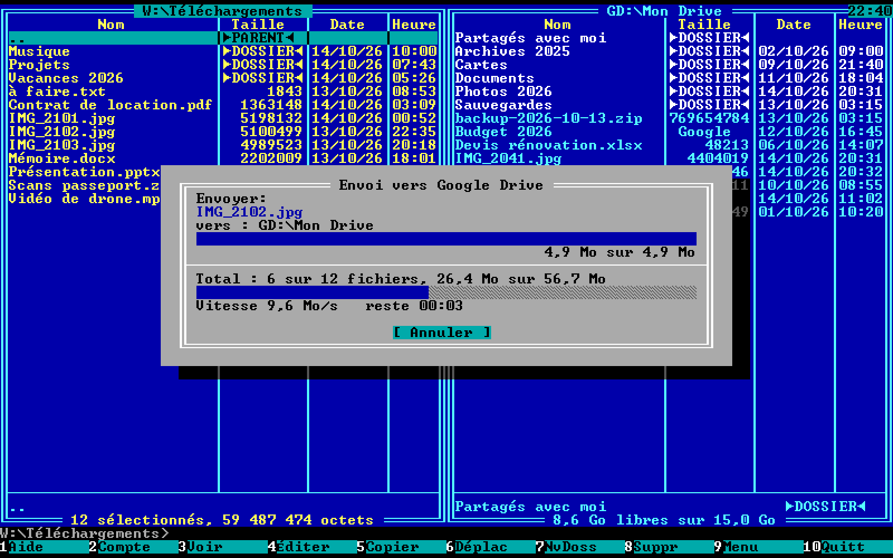

## Español

Gestor de archivos de dos paneles al estilo de Norton Commander: su ordenador a la izquierda y su Google Drive a la derecha.
Inicio de sesión con su cuenta de Google en el navegador (F2), espacio libre abajo en el panel, F5 sube y descarga.
Configuración de la clave de Google: vea arriba o F1.

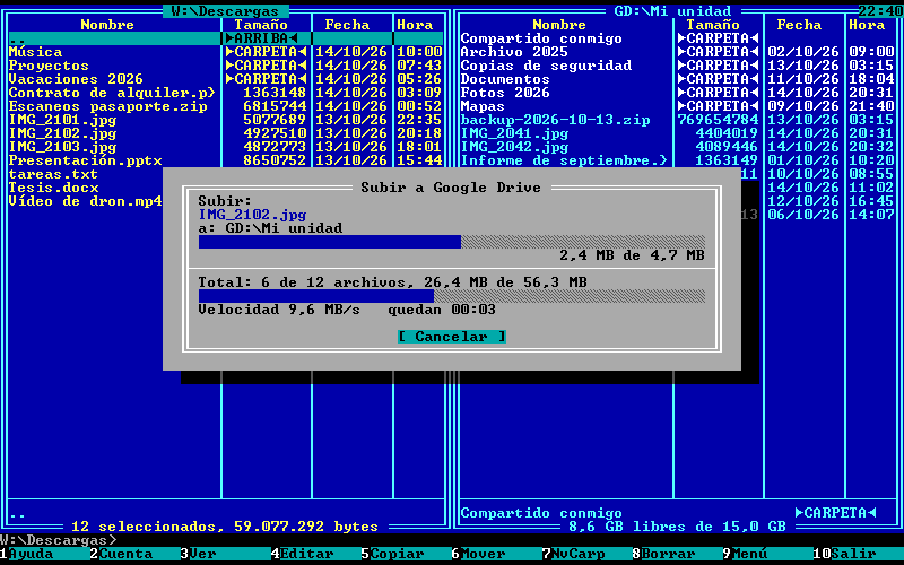

---

## Project layout

- `app/main.js` — window, IPC, reading the raster fonts from `.fon`
- `app/auth.js` — Google sign-in (loopback 127.0.0.1 + PKCE), token refresh
- `app/drive.js` — Google Drive API v3: listing, quota, folders, trash, resumable upload, download / export
- `app/transfer.js` — F5 / F6 between any panels, "file exists" and error questions
- `app/i18n.js` — translations (ru, en, de, fr, es)
- `app/ui/app.js` — text-mode screen on canvas, panels, menus, dialogs, viewer

## License

[MIT](LICENSE)
